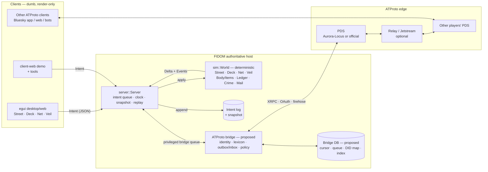
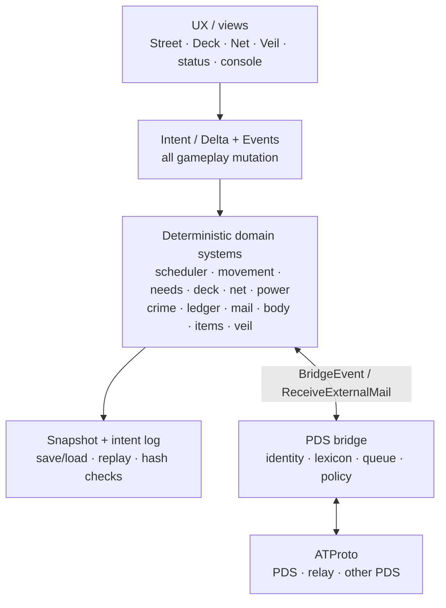
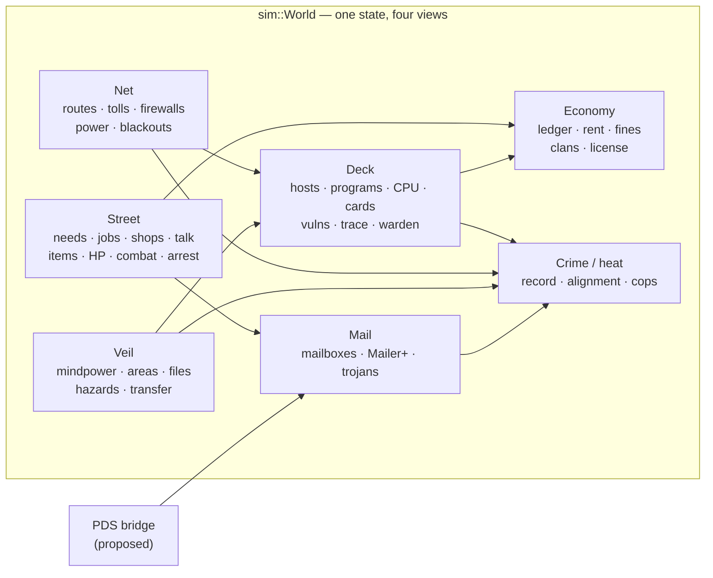
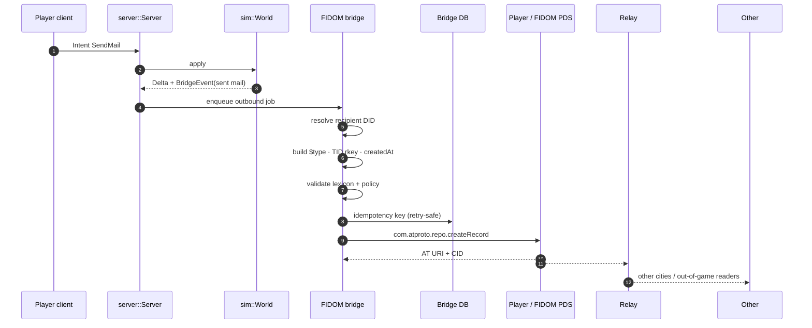
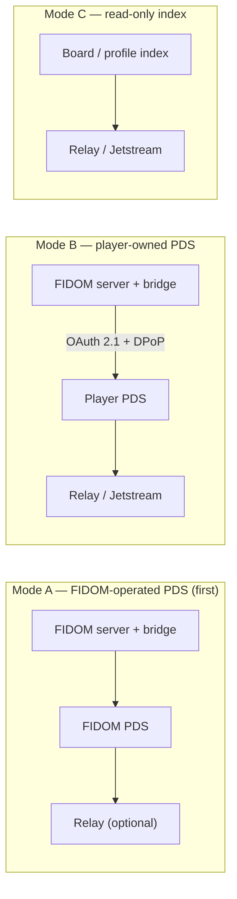
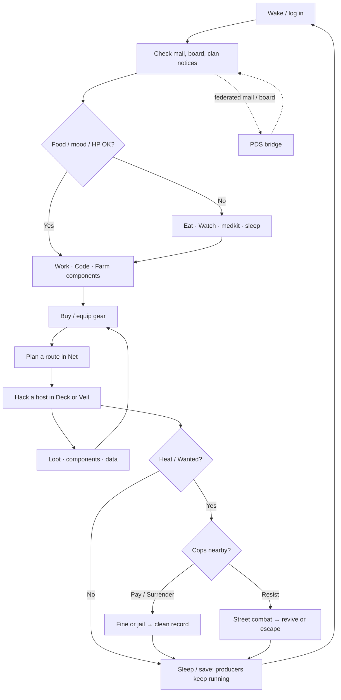
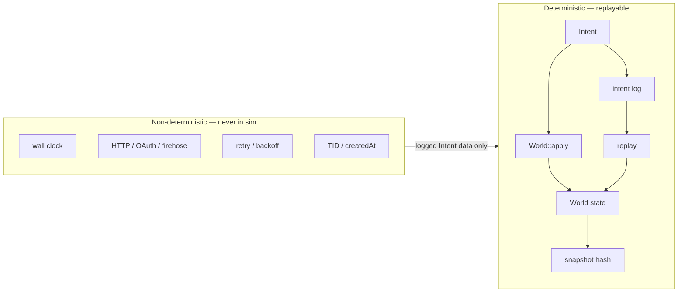

# Proposed Architecture — v0.4 + PDS Bridge

> Status: v0.4 is implemented; the PDS bridge is proposed (see
> `docs/PDS-BRIDGE-REQUIREMENTS.md`). This document is the system view:
> what runs where, what crosses which boundary, and how the architecture
> turns into gameplay.

## 1. One-sentence architecture

**A deterministic authoritative sim, wrapped by a server that accepts
`Intent`s and owns time/replay, with a separate PDS bridge that turns
asynchronous ATProto records into logged sim intents — never direct state
writes.**

## 2. Container diagram



Key properties:

- Clients never mutate the world; they submit intents and render what the
  server returns.
- `sim::World` has no clock, network, filesystem, or threads.
- `server::Server` owns wall time, the intent queue, snapshots, and the
  replay log.
- The bridge is **outside** the sim and outside the tick. It is the only
  component that talks to ATProto.
- The bridge has no `&mut World`; inbound mail becomes a privileged
  `Intent`, and outbound mail is surfaced as a `BridgeEvent`.

## 3. Layered view



The important line is the middle: **the bridge can produce intents, but it
cannot reach into the domain layer.**

## 4. Gameplay systems inside the one sim



Why this matters for play:

- A job pays into the same ledger that buys gear and pays fines.
- Gear and HP make Street combat and cop pursuit real.
- A Deck kill files a crime that Street cops act on.
- A Net cut blackouts a section and ejects Veil users.
- A federated mail can arrive from another city without inventing a second
  combat or economy system.

## 5. Inbound ATProto mail — sequence

```mermaid
sequenceDiagram
    autonumber
    participant Sender as Sender PDS
    participant Relay as Relay / PDS
    participant Bridge as FIDOM bridge
    participant Store as Bridge DB
    participant Server as server::Server
    participant World as sim::World
    participant Player as Player client

    Sender->>Relay: createRecord sh.fidom.mail
    Relay-->>Bridge: #commit firehose or listRecords poll
    Bridge->>Bridge: validate $type · lexicon · size · datetime
    Bridge->>Store: dedupe by AT URI + CID
    Bridge->>Bridge: resolve DID → handle/status
    Bridge->>Store: map DID → EntityId
    Bridge->>Bridge: rate-limit · blocklist · mailbox backpressure
    Bridge->>Server: privileged Intent ReceiveExternalMail
    Server->>Server: append to intent log
    Server->>World: apply(intent)
    World->>World: deliver to mailbox (cap 20)
    World-->>Player: inbox changes
    Player->>World: OpenMail
    Note over World: attachments never auto-run;<br/>trojan/trace rules apply in-sim
```

The bridge can retry or hold pending mail; it cannot bypass the mailbox
cap or write the mailbox directly. Replay sees the same
`ReceiveExternalMail` intent and reproduces the same world hash.

## 6. Outbound ATProto mail — sequence



Local play does not wait for the PDS. If the PDS is down, the local send is
still recorded, the outbound job stays queued, and the sim keeps ticking.

## 7. Deployment modes



- **Mode A** is the playable first step: one PDS sidecar, one bridge, no
  third-party consent flow.
- **Mode B** is federation: player identity and data live on the player’s
  PDS; the bridge is an ATProto client/AppView.
- **Mode C** gives global job/clan/character search without taking write
  responsibility.

## 8. The gameplay loop the architecture supports



The federated layer is deliberately **asynchronous**: it adds social
reach and off-screen consequences, but it never blocks the turn loop,
never runs during `apply`, and never supplies executable content.

## 9. How each architectural choice supports gameplay

| Architecture choice | Gameplay consequence |
|---|---|
| One deterministic `World`, four views | Street, Deck, Net, and Veil share entities, clock, ledger, crime, and permissions; a hack can change the street, and a street arrest can end a run. |
| Server-owned clock + intent queue | Turn order, needs/rent, NPC schedules, and combat are consistent; save/load and replay can reproduce a session. |
| Clients are dumb | Desktop, web, headless demo, and future bots all use the same rules; no client-side cheating or divergent combat math. |
| Bridge outside the sim | PDS latency, OAuth redirects, retries, and outages cannot stall a turn or corrupt determinism. |
| Inbound mail as a logged `Intent` | External mail is replayable and auditable; the bridge cannot silently rewrite a mailbox or grant items. |
| Outbound `BridgeEvent` + queue | Sending mail is instant locally; cross-city delivery is eventually consistent and retry-safe. |
| DID is canonical, handle is display | Player identity survives city/server travel, handle changes, and PDS migration. |
| Mail capped at 20 with pending queue | Federated mail cannot flood or crash a mailbox; overflow becomes visible gameplay pressure. |
| Trojans stay local | ATProto is a social/data edge, not a malware delivery system; in-game trojans keep their trace/crack rules. |
| PDS sidecar (Mode A) | The first federated build is deployable without asking players for OAuth consent; later switches to Mode B without changing sim rules. |
| Relay/Jetstream optional | The game works with polling first; firehose is an optimization, not a launch dependency. |
| `data/*.yaml` + `lexicons/*.json` | Jobs, cards, items, vulns, and federated record shapes are content, not hard-coded systems. |
| Bridge DB (cursor, queue, DID map, index) | Offline resilience, dedupe, global board/profile search, and operator recovery all have a home outside the sim. |

## 10. Trust and determinism boundary



Rules the diagram encodes:

- Wall clock, TIDs, OAuth tokens, and network retries live only in the
  bridge/server edge.
- Anything that changes gameplay crosses the boundary as an `Intent` with
  its external metadata already resolved.
- The intent log is the source of truth for replay; the bridge DB is
  operational state, not the game state.

## 11. Requirement mapping

| Component | Requirements | Gameplay effect |
|---|---|---|
| Identity resolver + DID map | BR-1, BR-6, BR-11 | Persistent player identity; cross-city mail reaches the same character. |
| Lexicon validator | BR-3, BR-12 | Only well-formed mail/board/profile enters; no malformed data crashes a view. |
| Outbound writer + queue | BR-2, BR-4, BR-8 | Mail/clan notices leave the city without blocking play; retries survive downtime. |
| Inbound poller/firehose | BR-5, BR-12, BR-13, BR-17 | Other cities’ mail and boards arrive; gaps resync. |
| Sim adapter (`ReceiveExternalMail`) | BR-7, BR-10 | Federated mail is replayable and subject to mailbox/trace rules. |
| Policy/moderation | BR-9, BR-14, BR-16 | Spam, blocks, and takedowns do not become unstoppable in-game spam. |
| Board/profile index | BR-18 | Global job board, clan notices, and character search. |
| Blob/attachment path (P1) | BR-15 | Non-executable files/avatars; attachments must be opened in-sim. |

## 12. Current vs proposed

| Layer | Now | Proposed next |
|---|---|---|
| Clients | egui desktop/web, headless demo, tools | unchanged |
| Server | intent queue, clock, snapshots, replay, tokio runtime | bridge sidecar/host process |
| Sim | Street/Deck/Net/Veil, body/items/combat, crime, mail, Veil | `ReceiveExternalMail`, external provenance, outbound bridge event |
| Edge | lexicon validation only | identity, auth, XRPC, queue, ingest, policy |
| PDS | none | Mode A PDS sidecar (Aurora-Locus candidate or official) |
| Relay | none | optional relay/Jetstream for cross-city and search |

## 13. What this architecture deliberately does not do

- No ATProto traffic inside `sim/`.
- No direct PDS write from the GUI.
- No automatic execution of federated attachments or trojans.
- No federated positional `say`; local chat stays tick-synced and
  eavesdroppable.
- No full-network AppView/relay at launch; start with one PDS and polling.
- No bridge access to private game state (position, inventory, host graph,
  private logs).
